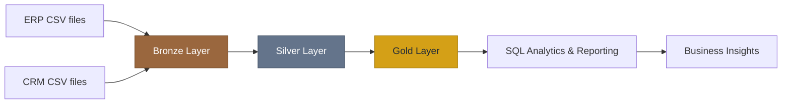

<div align="center">

# 🏗️ Data Warehouse & Analytics

### From scattered sales data to structured, decision-ready insights.

**A SQL Server data engineering and business intelligence portfolio project** exploring the journey from raw ERP and CRM files to an analytics-friendly warehouse.


</div>

---

## 🌟 Overview

Sales data often lives across multiple systems, making it difficult to answer even basic business questions consistently.

**Data Warehouse & Analytics** is designed around a simple idea: bring sales information from **ERP** and **CRM** datasets into one clean, understandable, analytics-ready model using **SQL Server**.

The project spans two connected areas:

| 🏗️ Data Engineering | 📊 Data Analytics |
|---|---|
| Ingest raw CSV data from ERP and CRM systems | Explore customer behavior |
| Clean and standardize data | Evaluate product performance |
| Integrate sources into a unified data model | Analyze sales trends |
| Organize transformations across Bronze, Silver, and Gold layers | Support reporting and business decisions |

> **Goal:** Turn raw operational records into a reliable foundation for meaningful business insights.

## 🎯 Project Objectives

### 01 · Build the Data Warehouse

- **Source integration:** Ingest the provided ERP and CRM CSV datasets.
- **Data quality:** Identify and resolve missing, inconsistent, or otherwise unreliable values.
- **Unified modeling:** Combine source data into a model that is easier to query and understand.
- **Current-state scope:** Focus on the latest available dataset rather than historical version tracking.
- **Documentation:** Record data models and definitions for technical and business audiences.

### 02 · Develop Analytics & Reporting

Use SQL to investigate:

- **Customer behavior:** Patterns in customer activity and sales.
- **Product performance:** Products contributing to business results.
- **Sales trends:** Revenue and sales patterns over time.

These are the **intended analysis areas**; this overview does not claim specific measured findings or dashboard outputs.

---

## 🧱 Architecture · Bronze → Silver → Gold



| Layer | Responsibility | Why it matters |
|---|---|---|
| 🟤 **Bronze** | Load source records from ERP and CRM CSVs | Preserve a clear starting point for transformation |
| ⚪ **Silver** | Clean, standardize, and integrate data | Improve consistency and trustworthiness |
| 🟡 **Gold** | Create analytics-oriented models | Make business questions easier to answer with SQL |

**Scope note:** The project description specifies **latest-data processing only**; it does not require historization or slowly changing dimensions.

## 🧰 Technology Stack

| Area | Technology / Approach |
|---|---|
| Database & warehouse | **Microsoft SQL Server** |
| Querying & analytics | **SQL** |
| Input data | **ERP and CRM CSV files** |
| Transformation | **ETL scripts** organized by layer |
| Modeling | **Analytics-focused data models / star schema documentation** |
| Design documentation | **Draw.io diagrams** and data catalog |
| Data quality | **SQL checks and tests** |

---

## 📂 Repository Structure

```text
data-warehouse-project/
│
├── datasets/                   # Input ERP and CRM CSV datasets
├── docs/                       # Architecture and model documentation
│   ├── etl.drawio              # ETL process design
│   ├── data_architecture.drawio
│   ├── data_catalog.md         # Data dictionary / metadata
│   ├── data_flow.drawio
│   └── data_models.drawio      # Analytical / star schema designs
│
├── scripts/
│   ├── bronze/                 # Raw source ingestion
│   ├── silver/                 # Cleaning and transformation
│   └── gold/                   # Analytics-ready models
│
├── tests/                      # Data quality and verification checks
├── naming-conventions.md      # Object naming standards
├── requirements.txt           # Listed dependencies (if applicable)
├── .gitignore
├── LICENSE
└── README.md
```

> Repository paths are shown as described in the original project overview. Check actual folder and script names when running the project.

## 🔍 Analytics Questions

Here are examples of the **questions this warehouse is intended to help explore**, rather than claims about existing results:

| Focus | Example business question |
|---|---|
| 👥 Customers | Which customer segments account for the most sales? |
| 🛍️ Products | Which products contribute the most revenue? |
| 📈 Sales | How do sales change over time? |
| 🔎 Quality | Are there missing or inconsistent customer/product identifiers? |

## 🚀 Getting Started

1. **Prepare SQL Server.** Install or connect to a SQL Server instance and a SQL client such as SQL Server Management Studio.
2. **Review the sources.** Inspect the ERP and CRM files under `datasets/` and the definitions in `docs/data_catalog.md`.
3. **Review the architecture.** Open the diagrams under `docs/` to understand the intended load sequence and models.
4. **Run SQL scripts in layer order:** `scripts/bronze/` → `scripts/silver/` → `scripts/gold/`.
5. **Validate outputs.** Review checks in `tests/`, then run the relevant analytics queries.

**Important:** Exact SQL Server initialization commands, database names, and executable script filenames were not provided in the source README, so they are intentionally not invented here. Follow the scripts and any repository-specific instructions before running against a database.

---

## 🖼️ Project Showcase

Add real screenshots or exported diagrams to help visitors understand the project at a glance.

| Suggested visual | What to capture |
|---|---|
| **Warehouse architecture** | Bronze → Silver → Gold architecture diagram |
| **Data model** | Star schema / fact and dimension relationships |
| **SQL transformations** | A readable Bronze, Silver, or Gold SQL script |
| **Analytics output** | Real SQL query results for customers, products, or sales |

<!-- After adding actual images, replace this note with links such as:


-->

## 🧠 Skills Demonstrated

`SQL Server` · `Data Warehousing` · `ETL` · `Data Cleaning` · `Data Integration` · `Data Modeling` · `Star Schema Design` · `SQL Analytics` · `Data Quality` · `Technical Documentation`

## 🗺️ Possible Next Steps

- Add clearly documented, reproducible execution scripts.
- Expand automated checks for source-to-target data quality.
- Build a visual BI dashboard using the Gold-layer models.
- Add a small set of verified business metrics and screenshots.
- Explore historization if future business requirements call for it.

These are **potential improvements**, not features claimed as already implemented.

## 📄 License

This project is described as licensed under the **MIT License**. See [LICENSE](LICENSE) for the repository's actual license text.

## 👩‍💻 About the Developer

**Iqra Nawaz** — Data Science student at NED University, interested in transforming data into useful products through SQL, analytics, machine learning, and data engineering.

> *Great analysis starts long before a chart — with data you can understand and trust.*

<div align="center">

**⭐ If this project is useful, consider starring the repository!**

</div>
